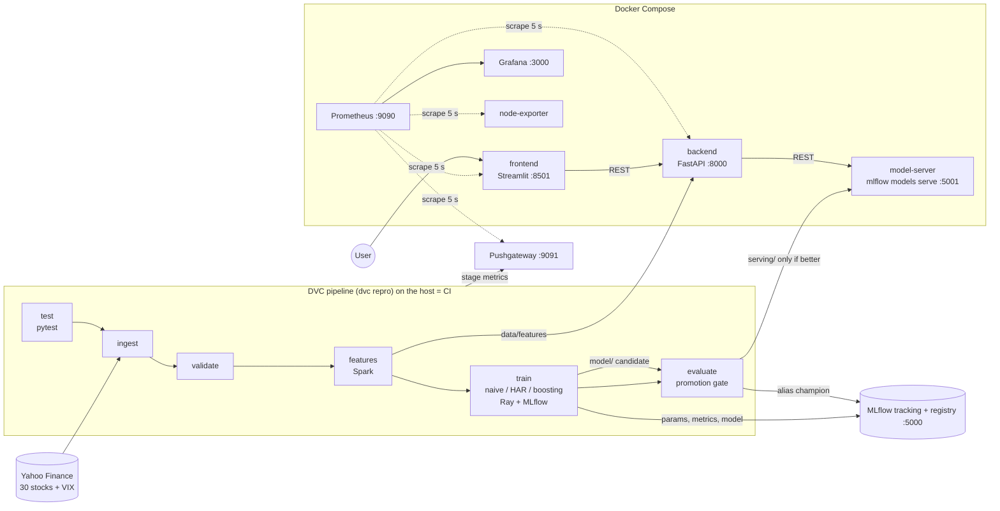

# Next-week stock volatility forecaster

Forecasts a stock's realised volatility over the next 5 trading days from daily OHLCV data (30 S&P 500 stocks
and the VIX, 2015-2025, Yahoo Finance) and shows it in a web UI with a low / medium / high risk level.
DVC pipeline (CI) → Spark features → Ray-parallel training with MLflow tracking → MLflow model server → FastAPI
backend → Streamlit UI, in Docker Compose, monitored with Prometheus and Grafana.

**Evaluators:** see [INSTRUCTIONS_FOR_TAS.md](INSTRUCTIONS_FOR_TAS.md) for the rubric checks and the step-by-step run, and [TEST_PLAN.md](TEST_PLAN.md) for the test plan and report.

## 1. Architecture



| Block | Role |
|---|---|
| DVC pipeline | Runs stages in order, re-runs only what changed, versions data and models (`dvc.lock`); gates stop the run on failure |
| ingest / validate | Downloads adjusted OHLCV + VIX (checkpointed per ticker); 10 data-quality rules |
| features (Spark) | Garman-Klass daily variance, HAR terms (1/5/22 days), 5-day return, relative volume, VIX join, forward 5-day target |
| train (Ray, MLflow) | Naive vs HAR vs 32-point boosting grid (Ray, sequential timing for comparison); best on validation QLIKE is the candidate |
| evaluate | Candidate vs naive on 2023-2025; only if better: copy to `serving/` and set registry alias `champion` |
| model-server | `mlflow models serve` on `serving/`; reachable by the backend only |
| backend (FastAPI) | The UI's only API: picks the feature row for ticker and date, calls the model, converts to %, buckets, drift, `/metrics` |
| frontend (Streamlit) | UI for non-technical users; knows only `BACKEND_URL` |
| Prometheus, Pushgateway, node-exporter, Grafana | Metrics from every component (pipeline via Pushgateway), 5 alert rules, live dashboard |

Frontend and backend are separate containers connected only by REST, configured by `BACKEND_URL` and `MODEL_URL`
in `docker-compose.yml`.

## 2. Design documents

- [docs/hld.pdf](docs/hld.pdf): **high-level design** with the architecture diagram, block responsibilities, design decisions with rationale and
  alternatives, and the operations design (reproducibility, deployment and rollback, drift, retraining, monitoring, scalability, security).
- [docs/lld.pdf](docs/lld.pdf): **low-level design** with modules, REST endpoints (inputs, outputs, errors), model-server contract, request flow,
  stage and data schemas, algorithms, MLflow contract, metrics, alerts, error handling and containers.

Key choices: functional paradigm (one function per stage); HAR and boosting compared with a naive benchmark, split by date (train 2015-2021,
validation 2022, test 2023-2025); log target with bias correction; risk level = tertiles of training volatility (14.3 % / 20.7 %); DVC gates (tests,
data rules, promotion) as CI; services load `serving/`, which `evaluate` replaces only if the candidate beats naive, so a worse model never reaches
users (rollback: `git checkout <commit> && dvc checkout`, restart `model-server` and `backend`); drift = mean z-score of the last 50 requests
(alert at |z| > 2); retraining = new `data.end` and `dvc repro` (or a weekly `cron`).

## 3. API

Backend (FastAPI, port 8000, `/docs`): `GET /health` (readiness: data loaded and model server up), `GET /tickers`, `GET /forecast/{ticker}?as_of=YYYY-MM-DD`
(forecast %, risk level, realised %, VIX, 120-day history; 404 unknown ticker or date, 422 bad date, 503 model server down), `GET /pipeline` (run history and
reports for the console), `GET /metrics`. Model server (port 5001): `GET /ping`, `POST /invocations` with the 7 features. Full definitions: [docs/lld.pdf](docs/lld.pdf).

## 4. User manual

See [docs/user_manual.pdf](docs/user_manual.pdf): how to open the app, read the forecast, risk level, charts and the date slider, an example, what to do when something goes wrong, and the Pipeline tab for administrators. The app itself also has a *Help* tab with the same quick help. Open **http://localhost:8501** in a browser.

## 5. Files

| File | Purpose |
|---|---|
| `pipeline.py` | All stages: `python pipeline.py ingest\|validate\|features\|train\|evaluate` |
| `backend.py`, `frontend.py` | FastAPI backend, Streamlit UI |
| `test_project.py` | 11 unit and API tests |
| `dvc.yaml`, `params.yaml` | DAG and all parameters (tickers, dates, windows, grid, gate) |
| `docs/` | `hld.pdf` (high-level design), `lld.pdf` (low-level design), `user_manual.pdf` (user manual) |
| `TEST_PLAN.md` | Test plan, acceptance criteria, test cases and test report |
| `pyproject.toml` | Lint configuration (ruff: PEP 8 style, imports, naming) |
| `Dockerfile`, `docker-compose.yml` | Three images (model-server, backend, frontend), full stack |
| `MLproject`, `python_env.yaml`, `requirements.txt` | Pinned environment and entry points |
| `monitoring/` | Prometheus config and rules, Grafana data source and dashboard |
| generated | `data/`, `model/` (candidate), `serving/` (promoted), DVC-tracked; `reports/`; `mlflow.db`, `mlruns/` |

## 6. Setup and run

Needs Python 3.14, Java 17, Docker with Compose v2, uv, git-lfs.
```bash
uv venv --python 3.14 .venv && source .venv/bin/activate
UV_LINK_MODE=copy uv pip install -r requirements.txt
export MLFLOW_TRACKING_URI=sqlite:///mlflow.db
docker compose up -d prometheus pushgateway node-exporter grafana   # monitoring first: it receives pipeline metrics
dvc repro                                                           # test → ingest → validate → features → train → evaluate
docker compose up -d --build                                        # model-server, backend, frontend
mlflow ui --backend-store-uri sqlite:///mlflow.db --port 5000       # separate terminal
```
UI :8501 (open once so Prometheus can scrape it) · API docs :8000/docs · model server :5001/ping · MLflow :5000 · Grafana :3000 · Prometheus :9090.
Stop: `docker compose down`. MLflow Project: `mlflow run . -e test --env-manager uv --experiment-name volatility`.
An interrupted `dvc repro` resumes at the first unfinished stage; ingest keeps each downloaded ticker in `.cache/`.
Reproduce a run: its MLflow tags `git_commit` and `data_md5` → `git checkout <commit> && dvc checkout`.

## 7. Results

| | QLIKE | RMSE | RMSPE |
|---|---|---|---|
| Validation 2022: naive / HAR / boosting | 0.159 / 0.132 / 0.117 | 0.070 / 0.064 / 0.063 | 0.281 / 0.233 / 0.238 |
| Test 2023-2025: naive / champion (boosting) | 0.206 / 0.150 | 0.074 / 0.063 | 0.321 / 0.261 |

Spark features about 16-20k rows/s on 83k rows; Ray grid of 32 fits 4.2-4.4x faster than sequential on 8 CPUs.
Limitations: Garman-Klass ignores overnight gaps; 30 surviving large caps; Spark and Ray are oversized for 83k rows
(used to show the scaling path); training runs on the host (Spark and Ray need its cores), serving is containerised.

Video: https://drive.google.com/file/d/1W8IOGvnm7rZY4ft6qQA_y5Ore_4f6OqZ/

## 8. AI disclosure
AI tools/agents were used to assist in the development process of this project
- **Boilerplate:** drafting of `docker-compose.yml`, `Dockerfile`, `dvc.yaml`, `MLproject` and the Prometheus and Grafana files.
- **Code:** scriting `pipeline.py` (Spark window features, Ray grid search, MLflow logging), `backend.py`, `frontend.py` and the tests.
- **Debugging:** diagnosed errors from logs (Ray's GPU probe, Ray workers failing on a path with spaces, Yahoo rate limits, lint errors).
- **Documentation:** drafted this README, `INSTRUCTIONS_FOR_TAS.md` and the design documents. They were used to draft structure, and refine language.
- **Impact:** faster scripting, debugging and document production. All numbers in this repository come from running the pipeline manually.
